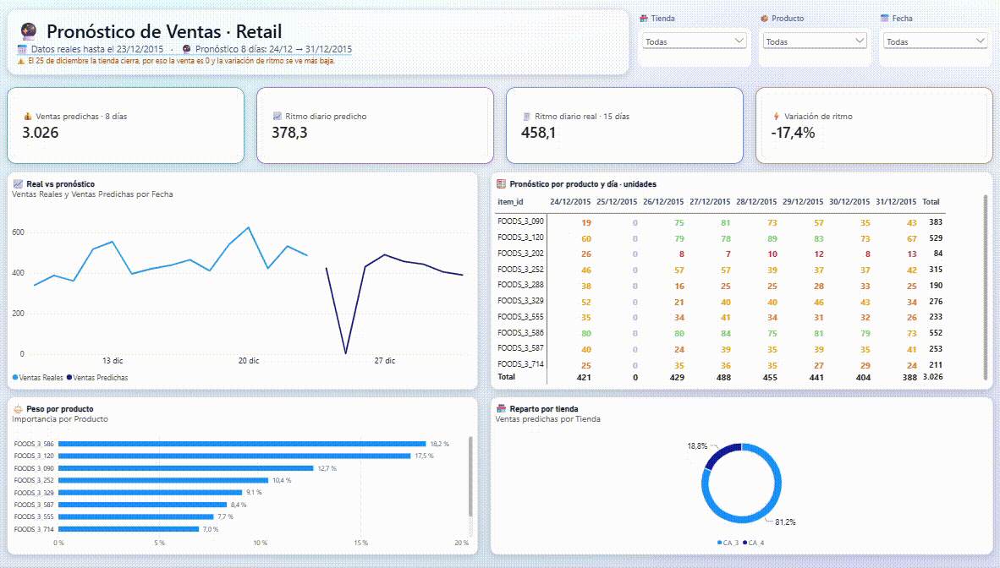
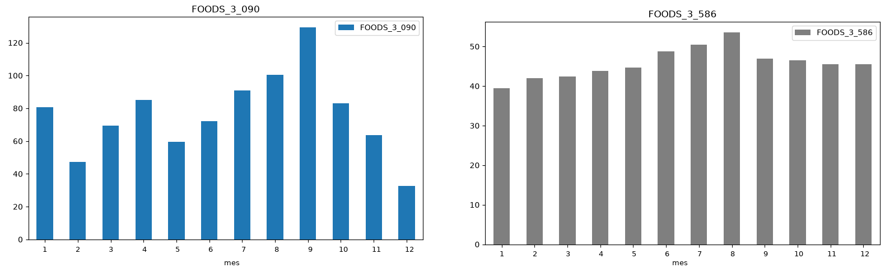

# Forecasting Retail: pronóstico de ventas a 8 días con tablero en Power BI

Proceso en Python que predice, para 20 series (2 tiendas por 10 productos), cuánto se va a vender en los próximos 8 días, y un tablero en Power BI que muestra el pronóstico y mide qué tan confiable es.



## El problema de negocio

Quien repone inventario necesita responder una pregunta: **cuánto se va a vender los próximos 8 días, en qué tienda y en qué producto, y cómo va contra lo reciente.** El proyecto entrega esa respuesta cada día en un archivo simple (`predicciones.csv`) y un tablero que lo hace legible para áreas que no programan.

## Resultado en una mirada

| Pregunta | Respuesta |
|---|---|
| ¿Cuánto se espera vender del 24 al 31 de diciembre de 2015? | 3.026 unidades, 378,2 por día. Los últimos 15 días reales promediaron 458,1 por día |
| ¿Qué tanto se equivoca el modelo? | 8,77 unidades por serie y día (MAE) en cuatro ventanas de prueba de diciembre |
| ¿Vale la pena frente a una regla simple? | Sí. La regla simple (vender lo mismo que hace 7 días) se equivoca 10,30, así que el modelo mejora 14,8 % |
| ¿Se pasa o se queda corto? | En promedio se pasa un 1,9 %, con una excepción importante (ver hallazgos) |
| ¿Y si se deja fuera el producto que se apagó en diciembre? | El error baja a 7,25 contra 9,09 de la regla simple, una mejora de 20,2 %. Se explica en el hallazgo 3 |

El 25 de diciembre el pronóstico es 0 por una regla de negocio: la tienda cierra.

## Qué muestra el tablero

**Página 1, Pronóstico (para el usuario final).** Ventas esperadas en 8 días, ritmo diario contra los últimos 15 días reales, línea de real y pronóstico, matriz de producto por día, peso de cada producto y reparto por tienda. Con filtros de tienda, producto y fecha.

**Página 2, Confiabilidad (para el analista).** Error del modelo contra la regla simple, mejora en porcentaje, sesgo, error por ventana de prueba, error según el día del horizonte (1 a 8) y detalle por producto con formato condicional.

## Cómo funciona

```
hipermercado.db → consulta SQL → DatosParaProduccion.csv (15 días reales + 8 por predecir)
                → ejecuciones.py (recursivo, 20 modelos) → predicciones.csv → Power BI

exportar_backtest.py → backtest.csv (4 ventanas de diciembre) → página 2 de Power BI
```

La idea que ordena el proyecto: **todo el trabajo difícil ocurre en Python y Power BI es solo la capa de presentación.** Power Query hace limpieza ligera, el modelo de datos es una estrella simple y las medidas DAX son pocas y están documentadas.

**El modelo.** Un modelo por serie (20 en total) con `HistGradientBoostingRegressor`. Cada uno usa 75 variables elegidas por información mutua: ventas de los 15 días anteriores, precios de los 7 anteriores, mínimos, máximos y medias móviles, una variable de posible rotura de stock (3, 7 y 15 días seguidos en cero) y calendario (mes, día de la semana, eventos).

**Pronóstico recursivo.** El modelo predice un solo día. Para predecir 8, cada predicción se escribe como si fuera la venta de ese día y alimenta los rezagos del siguiente. Por eso el error crece con el horizonte.

**Regla de negocio.** El 25 de diciembre se fuerza a 0 porque en tres años el modelo vio solo dos Navidades por producto, muy pocas para aprenderlo solo.

**Métrica.** MAE, en unidades por día. Se descartó el MAPE porque hay días con venta cero.

**Entrenamiento y validación.** Entrenado con datos del 1 de enero de 2013 al 30 de noviembre de 2015. La validación es diciembre de 2015, separada por tiempo para no mezclar pasado y futuro.

## Cómo se evaluó

Una sola ventana mide poco, así que la evaluación se repite en cuatro semanas de diciembre. En cada corte el modelo ve solo 15 días reales y predice los 8 siguientes a ciegas. Se compara contra lo que realmente se vendió y contra la regla simple.

| Ventana de prueba | Regla simple | Modelo |
|---|---|---|
| 1 al 8 de diciembre | 16,17 | 9,55 |
| 9 al 16 de diciembre | 8,31 | 7,89 |
| 17 al 24 de diciembre | 6,91 | 8,97 |
| 24 al 31 de diciembre | 9,81 | 8,69 |
| Promedio | 10,30 | 8,77 |

El modelo gana en 3 de las 4 ventanas y es más parejo (su error va de 7,9 a 9,6, el de la regla simple de 6,9 a 16,2). En la del 17 al 24 gana la regla simple.

## Hallazgos

1. **El modelo supera a la regla simple, pero no siempre.** La regla funciona cuando las semanas se parecen y falla cuando la semana anterior fue atípica. Mostrar la ventana donde pierde es parte del resultado.
2. **El error crece con el horizonte.** Pasa de 6,8 unidades en el día 1 a 9,3 en el día 8, por el efecto recursivo.
3. **Un solo producto explica la mayor parte del error de CA_4, y no es un fallo del proceso.** FOODS_3_090 vendía unas 3.500 unidades al mes en CA_3 y unas 900 en CA_4, y desde el 1 de diciembre casi dejó de venderse en las dos tiendas (202 y 42 unidades en todo diciembre). Diciembre se apartó desde el inicio como validación, así que ni el análisis exploratorio ni el entrenamiento (hasta el 30 de noviembre) podían ver ese cambio. En las pruebas el modelo predijo 806 unidades en CA_4 contra 42 reales.

   

   *Ventas diarias medias por mes del entrenamiento (2013 a noviembre de 2015, promedio de las dos tiendas). A la izquierda FOODS_3_090, que sube hasta septiembre y baja tres meses seguidos hasta diciembre, su mes más bajo (unas 33 unidades). A la derecha FOODS_3_586, un producto estable como referencia.*

   | Medida | Con FOODS_3_090 | Sin FOODS_3_090 |
   |---|---|---|
   | Error del modelo | 8,77 | 7,25 |
   | Error de la regla simple | 10,30 | 9,09 |
   | Mejora del modelo | 14,8 % | 20,2 % |
   | Error del modelo en CA_4 | 5,97 | 3,98 |

   El producto es el 10 % de las filas y concentra el 26 % del error. No se quita del resultado, porque la regla simple tampoco lo habría anticipado. Los datos no traen inventario ni catálogo, así que la causa no se puede comprobar: pudo ser stock agotado, salida del catálogo, reemplazo por otro producto o código, o una oferta que terminó. El gráfico apunta a una causa estacional: es un producto de temporada que ya caía hacia fin de año. Pero la caída de 2015 fue mucho mayor: unas 4 unidades por tienda y día en diciembre, contra unas 33 de media en los diciembres anteriores. Otra pista: en la Navidad de 2014 a 2015 ya había tenido 34 días en cero en CA_4, pero con una sola Navidad de historia no se sabe si es un patrón.
4. **Consecuencia para el pronóstico actual.** En los 15 días reales previos al corte, FOODS_3_090 vendió 34 unidades en CA_3 y ninguna en CA_4, y aun así el pronóstico le asigna 383 unidades en 8 días (12,7 % del total). Ese número debe tomarse con cautela y revisarse con el negocio antes de usarlo para pedidos. En producción la respuesta natural es reentrenar con los datos más recientes y vigilar el sesgo por producto, que es justo lo que muestra la página 2.
5. **La variación de ritmo de 17,4 % a la baja está inflada por la Navidad.** Con el 25 de diciembre en cero, el promedio diario del pronóstico baja. Sin ese día, los 7 días abiertos promedian 432,3, un 5,6 % por debajo del ritmo real reciente.

## Límites conocidos

* La parrilla de hiperparámetros tiene una sola opción: es un punto de partida y no un techo.
* Solo hay un diciembre (2015) para evaluar y los datos terminan el 31 de diciembre de 2015, sin un examen posterior.
* No hay datos de inventario, así que un quiebre de stock se ve como demanda cero.
* El análisis exploratorio no incluye diciembre de 2015 porque es la validación. Un cambio brusco en esas fechas, como el de FOODS_3_090, solo aparece al evaluar.
* `predicciones.csv` se sobrescribe en cada corrida y no guarda historial. Cada corrida solo trae pronóstico, sin ventas reales.
* Power BI Desktop lee archivos locales. Para un refresco automático en el servicio haría falta una puerta de enlace de datos o llevar los archivos a OneDrive o SharePoint.
* El Programador de tareas de Windows no corre con el equipo apagado. Para producción real esto iría en un servidor.

## Estructura del repositorio

| Carpeta | Contenido |
|---|---|
| `01_Documentos/` | Documentación del caso y bitácora |
| `02_datos/` | Originales, validación, entrenamiento y cachés (no se suben) |
| `03_notebooks/` | Pipeline por fases, de la importación (01) a la preproducción (08) |
| `04_scripts/` | Código reutilizable |
| `05_modelos/` | Modelos serializados (no se suben) |
| `06_resultados/` | Un informe en Markdown por fase |
| `07_despliegue/` | Proceso batch, backtest, datos del tablero y archivo de Power BI |
| `docs/` | Capturas y GIF del tablero |

## Cómo reproducirlo

**Entorno de Python**

```bash
uv sync                      # reproduce el entorno exacto
uv run jupyter lab           # abrir los notebooks
```

**Proceso batch** (siempre desde dentro de `07_despliegue`, los scripts leen archivos por nombre simple)

```bash
cd 07_despliegue
python reentrenamiento.py    # solo cuando haya datos nuevos
python ejecuciones.py        # genera predicciones.csv
python exportar_backtest.py  # genera backtest.csv (solo si se reentrena)
```

La base original (`hipermercado.db`), `train.pkl` y los modelos no están en el repositorio. Sin ellos se puede abrir y refrescar el tablero con los tres CSV incluidos, pero no regenerar el pronóstico.

**Tablero de Power BI**

1. Abre el archivo `.pbix` de `07_despliegue` (versión más reciente: `Tablero_Ventas_v3.pbix`).
2. En Transformar datos, abre Administrar parámetros y cambia `RutaBase` por la ruta de tu carpeta `07_despliegue`, sin la barra final.
3. Actualiza. Las fechas se leen con cultura `es-CO` y los decimales con `en-US`, ya configurado en las consultas.

## Documentación adicional

* [Cómo operar el despliegue](07_despliegue/instrucciones/explicacion.md) y [programar la ejecución diaria](07_despliegue/instrucciones/programador_tareas.txt)
* [Diccionario de métricas de Power BI](07_despliegue/Diccionario_Metricas_PowerBI.md)
* Informes por fase en `06_resultados/`, por ejemplo [preproducción y evaluación](06_resultados/Preproduccion/informe_preproduccion.md) y [modelización](06_resultados/Modelizacion/informe_modelizacion.md)

## Autor

Andrés Miranda, analista de datos.
